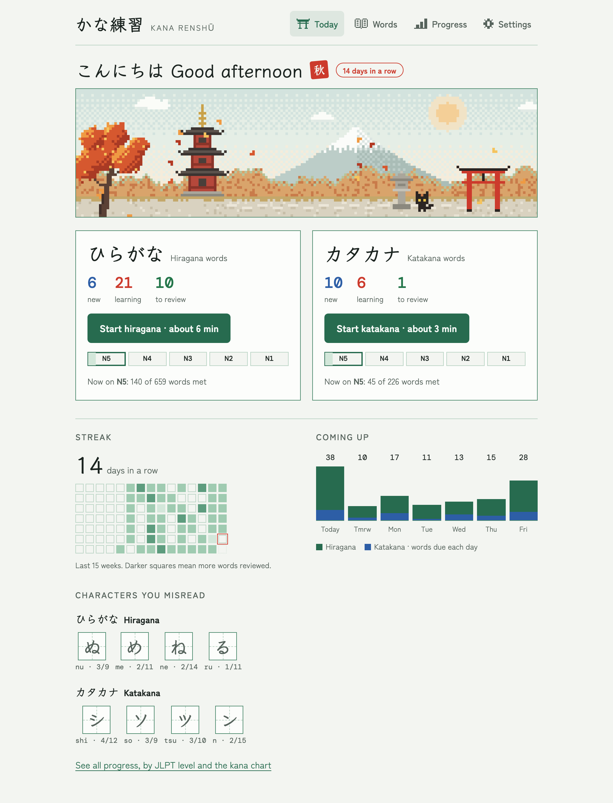
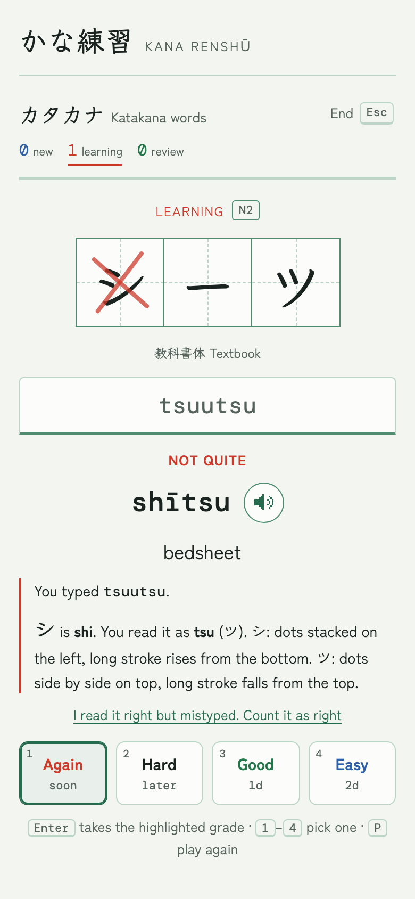
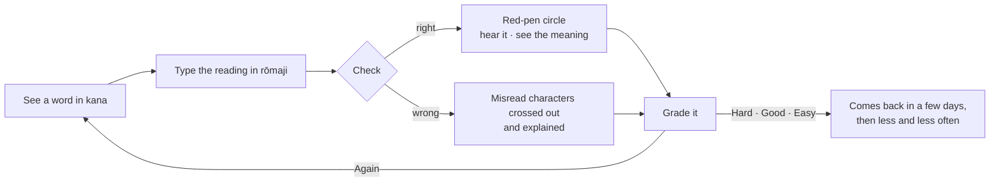
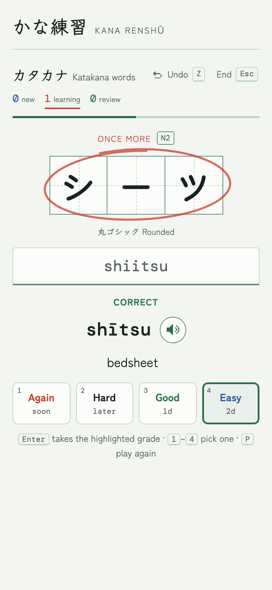
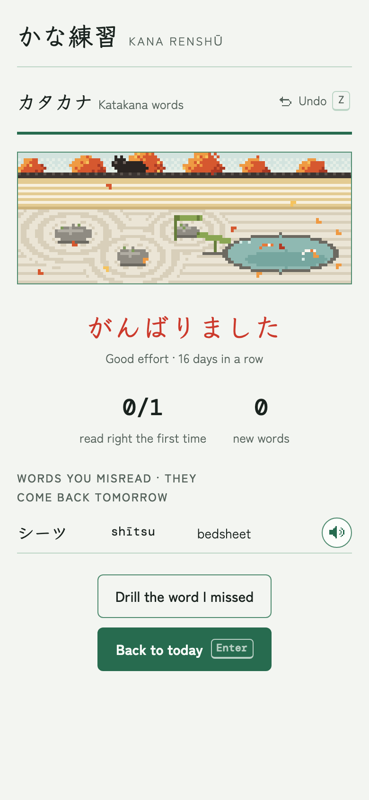
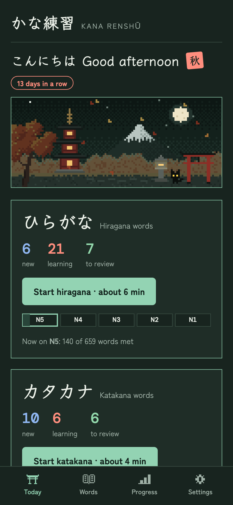
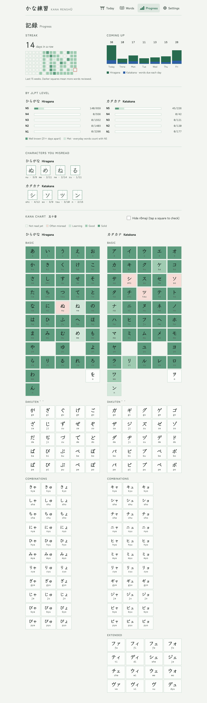
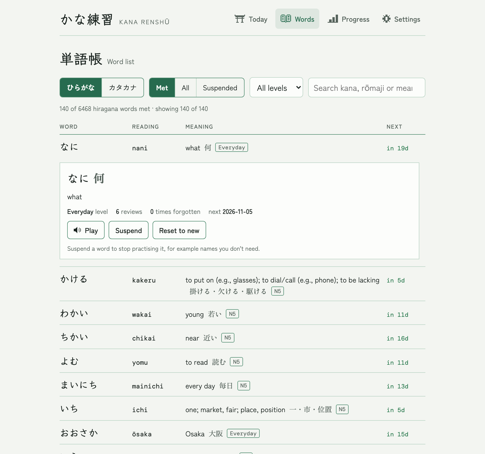
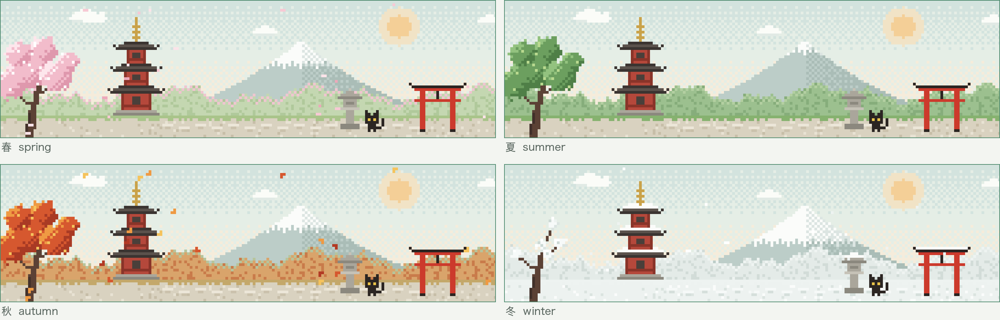
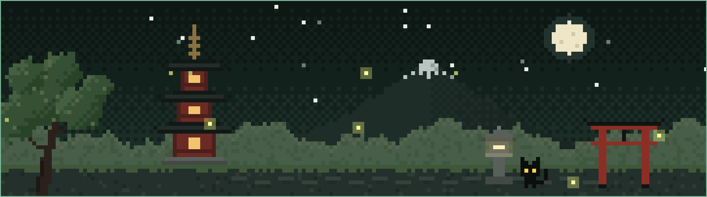

<p align="center">
  
</p>

<h1 align="center">かな練習 · Kana Renshū</h1>

<p align="center">
  Daily hiragana and katakana reading practice with real JLPT words,<br>
  Anki-style reviews, and a little pixel-art temple that changes with the seasons.
</p>

<p align="center">
  <a href="https://github.com/AyaBochman/kana-renshu/actions/workflows/test.yml"></a>
  
  
  
</p>

<p align="center">
  
  &nbsp;
  
</p>

---

Kana Renshū is for people who learned kana once and want to read again. Instead of drilling
single characters, you read **real words** written in kana, type how they sound, and learn what
they mean. When you misread something, the app shows exactly which character tripped you up.
A spaced-repetition scheduler, the same idea as Anki, brings each word back just before you'd
forget it.

It's a small web app you can install on your phone or computer. There are no accounts, no
server and no build step, and it works offline.

## Contents

- [How a session works](#how-a-session-works)
- [How answers are checked](#how-answers-are-checked)
- [How reviews are scheduled](#how-reviews-are-scheduled)
- [Words and JLPT levels](#words-and-jlpt-levels)
- [Progress and the word list](#progress-and-the-word-list)
- [The seasons](#the-seasons)
- [Your data](#your-data)
- [Run it, install it, host it](#run-it-install-it-host-it)
- [How the code is organised](#how-the-code-is-organised)
- [Contributing](#contributing) · [Credits](#credits) · [License](#license)

## How a session works

There are two decks, **ひらがな hiragana** and **カタカナ katakana**, practised separately. Each day a
deck offers the words due for review plus a few new ones (10 by default).



1. **Read.** The word appears in practice squares like a Japanese exercise book. Each word uses one of
   four typefaces (textbook, gothic, mincho or rounded), so you get used to all of them.
2. **Type** how it sounds in rōmaji and press Enter. Not sure? Press Enter with the box empty to see it.
3. **Check.** A right answer gets a red-pen circle. A wrong one gets the misread characters crossed out,
   with a short explanation ("シ is shi. You read it as tsu (ツ).") and a tip for telling lookalikes apart.
4. **Hear and learn.** The word is spoken with your device's Japanese voice, and you see its meaning
   and how it's usually written in kanji.
5. **Grade** it Again, Hard, Good or Easy. The app suggests a grade from whether you were right and
   how quickly you answered; Enter accepts it. Each button shows when you'd see the word next.

Made a typo but read it right? **"I mistyped"** counts it as right. Pressed the wrong grade?
**Undo** (or <kbd>Z</kbd>). At the end, a zen garden, a teacher's stamp (よくできました for a great
session), your new words with their meanings, and a button to **drill the words you missed**
without changing their schedule.

<p align="center">
  
  &nbsp;
  
  &nbsp;
  
</p>

**Keyboard:** <kbd>Enter</kbd> check / accept the suggested grade · <kbd>1</kbd>–<kbd>4</kbd> pick a grade ·
<kbd>P</kbd> play again · <kbd>Z</kbd> undo · <kbd>Esc</kbd> end the session.

## How answers are checked

Every word is split into reading units (a kana, a kana with a small ゃ/ゅ/ょ, a small っ, a long-vowel
mark ー, or ん), and each unit has the spellings people actually type:

| You can type | For |
|---|---|
| `shi` or `si`, `chi` or `ti`, `tsu` or `tu`, `fu` or `hu`, `ji` or `zi` | し ち つ ふ じ |
| `sha` or `sya`, `cha` or `tya`, `ja` or `jya` | しゃ ちゃ じゃ |
| `kko`, `tchi` or `cchi` | っこ っち (small っ doubles the next consonant) |
| `n` or `nn`, and `m` before b/m/p (`tempura`) | ん |
| `koohii`, `kōhī`, `kouhii` or `ko-hi-` | コーヒー (long vowels) |
| `konnichiwa` | こんにちは (particles are spelled out per word) |

**Long vowels matter.** Leaving one out (`arigato`, `biru` for ビール) still counts as right, but the
app points it out and suggests Hard. Where a long vowel makes a different word, like おばあさん
(grandmother) and おばさん (aunt), leaving it out is wrong.

**Finding the misread character.** When an answer is wrong, the app lines up what you typed against
the word's units (an edit-distance alignment) to work out which characters you misread and what you
read them as. It then checks a table of lookalikes (シ/ツ, ソ/ン, ぬ/め, ね/れ/わ, る/ろ, さ/ち…) for
a tip. Every misread is counted per character, which feeds the "characters you misread" list and the
kana chart.

The reading shown to you is Hepburn with macrons (`tōkyō`, `kōhī`), generated from the kana.

## How reviews are scheduled

Scheduling follows Anki's SM-2 algorithm. Every word has an interval (days until it's due) and an
ease (how fast the interval grows, starting at 2.5).

| Grade | New or learning word | Word in review |
|---|---|---|
| **Again** | Comes back a few cards later | Forgotten: back to 1 day, ease −0.20, relearn today |
| **Hard** | Comes back a bit later in the session | Interval × 1.2, ease −0.15 |
| **Good** | Due tomorrow | Interval × ease |
| **Easy** | Due in 4 days | Interval × ease × 1.3, ease +0.15 |

Answering Good every time gives intervals of **1, 3, 8, 20, 50, 125, 313 days**, so a word you know
well comes up a handful of times a year. Intervals get a little random spread so words learned
together don't stay bunched, at most 150 reviews are shown per deck per day, and a new day starts at
4 a.m., so late-night practice counts for the evening before.

## Words and JLPT levels

The decks hold **7,154 words**, each tagged with its JLPT level:

| | N5 | N4 | N3 | N2 | N1 | Everyday | Total |
|---|---:|---:|---:|---:|---:|---:|---:|
| ひらがな hiragana | 594 | 556 | 1,552 | 1,403 | 2,298 | 65 | **6,468** |
| カタカナ katakana | 59 | 42 | 121 | 120 | 177 | 167 | **686** |

Words written with kanji in everyday Japanese appear in their kana reading (えいきょう for 影響),
with the kanji shown after you answer. "Everyday" words and phrases (いただきます, ちょっと まって
ください, ジンジャーエール) aren't on the JLPT lists and are introduced with N5.

You choose where new words start (N5 to N1) when you first open the app, or later in Settings. New
words then come level by level, and within a level from easiest to read to hardest: plain kana,
then が/ぱ, then small っ/ゃ and long vowels, then phrases and extended katakana like ファ and ヴ.
Each deck shows a track of your progress through the levels.

## Progress and the word list

<p align="center">
  
  
</p>

- **Today** shows both decks, your streak, the reviews coming up this week and the characters you
  misread most.
- **Progress** adds progress per JLPT level and a kana chart coloured by how often you read each
  character right inside words. Hide the rōmaji and tap squares to quiz yourself.
- **Words** lists every word with its reading, meaning, level and next review. Tap one to hear it,
  suspend it (for example names you don't need) or reset it to new.

## The seasons

The scene on the Today screen is drawn in code, pixel by pixel, and follows the calendar: sakura
petals in spring, fireflies in summer, maple leaves in autumn, snow in winter. The light "notebook"
theme shows it by day; the dark "blackboard" theme shows it at night, with the moon out and the
lanterns lit. The black cat blinks and swishes its tail; now and then a crane flies past.

<p align="center">
  
</p>
<p align="center">
  
</p>

## Your data

Everything stays on your device, in the browser's local storage. Nothing is sent anywhere, and
there's no server to send it to.

- **Backup:** Settings → Export saves a progress file (on phones, through the share sheet).
- **Two devices:** export on one, import on the other, and choose **Merge**: every word keeps
  whichever copy you practised most recently, and practice days are combined.
- **Reset** clears progress but keeps your settings.

The app reminds you to back up if it's been more than 30 days.

## Run it, install it, host it

**Run locally.** Any static file server works:

```bash
npm start            # same as: python3 -m http.server 8080
```

Open http://localhost:8080. On localhost the service worker always fetches fresh files, so edits
show up on reload.

**Install as an app** (needs HTTPS or localhost):

- **iPhone / iPad:** Safari → Share → **Add to Home Screen**.
- **Android:** Chrome → menu → **Install app**.
- **Desktop Chrome / Edge:** the install icon in the address bar.

For the voice, the device needs a Japanese text-to-speech voice. Most have one; Settings → Sound
explains how to add one. On iPhone, the silent switch also mutes it.

**Host it.** Any static host works, with no build command and the repository root as the output:

- **Cloudflare Pages** or **Netlify**: free, and fine with a private repository.
- **GitHub Pages**: Settings → Pages → deploy from `main`. On a free plan the repository must be public.

**Test it.**

```bash
npm test             # node --test, no dependencies (Node 20+)
```

The tests cover rōmaji matching and misread detection, the scheduler, word ordering, import/export
and merging, every word in both decks, and the list of files cached for offline use.

## How the code is organised

Plain JavaScript modules, no framework and no build step.

```
index.html              markup for all screens
manifest.webmanifest    PWA manifest
sw.js                   service worker: offline cache and updates
src/
  main.js               start-up, navigation, keyboard, update prompt
  app.js                shared state, navigation, theme, kana squares and red-pen marks
  today.js              Today screen
  session.js            practice sessions: checking, grading, undo, drill, the end screen
  words.js              word list
  progress.js           streak, forecast, levels, misread characters, kana chart
  settings.js           settings and backup
  romaji.js             reading units, rōmaji, answer checking, misread alignment
  kana.js               kana tables, accepted spellings, lookalike tips
  srs.js                scheduling (SM-2), daily plan, forecast, streak
  decks.js              loading decks and ordering new words
  storage.js            saving, export, import, merging
  audio.js              speaking words with the device's voice
  scenes.js             pixel-art scenes and their animation
  icons.js              pixel icons
  styles.css            styles: "notebook" light and "blackboard" dark themes
data/                   hiragana.json, katakana.json
fonts/                  bundled fonts, trimmed to kana and Latin (and their license)
icons/                  app icons
scripts/                import-jlpt.mjs (merge JLPT lists), build-fonts.py (trim fonts)
tests/                  node:test suites
```

## Contributing

Corrections to meanings are very welcome, especially from native speakers. Words live in two JSON
files, one entry per line. See [CONTRIBUTING.md](CONTRIBUTING.md) for the format and how to run
the checks.

## Credits

- JLPT vocabulary from [open-anki-jlpt-decks](https://github.com/jamsinclair/open-anki-jlpt-decks)
  (MIT), based on Jonathan Waller's JLPT lists at [tanos.co.uk](http://www.tanos.co.uk/jlpt/)
  (Creative Commons BY). The JLPT has no official word lists; these are well-known community lists.
- Fonts: [Klee One](https://fonts.google.com/specimen/Klee+One),
  [Zen Kaku Gothic New](https://fonts.google.com/specimen/Zen+Kaku+Gothic+New),
  [Shippori Mincho](https://fonts.google.com/specimen/Shippori+Mincho),
  [Zen Maru Gothic](https://fonts.google.com/specimen/Zen+Maru+Gothic) and
  [DM Mono](https://fonts.google.com/specimen/DM+Mono), under the SIL Open Font License
  ([fonts/OFL.txt](fonts/OFL.txt)).
- Scheduling based on the SM-2 algorithm as used by [Anki](https://apps.ankiweb.net/).

## License

[MIT](LICENSE) for the code. Word data and fonts keep their own licenses, listed above.
